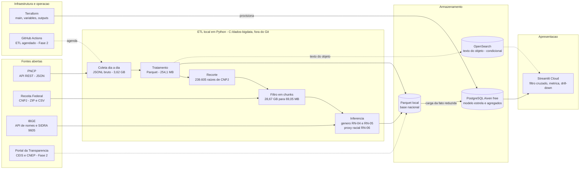

# Arquitetura da solução

Documento da 1ª Unidade. Descreve o desenho do pipeline, do dado bruto ao painel, e separa o que já está **implementado e medido** do que é **planejado para a Fase 2**. Os números vêm da coleta completa de 2025 e da competência 2026-09-14 da Receita.

## Diagrama

Linhas tracejadas indicam etapas da Fase 2 ou condicionais. O diagrama renderiza no GitHub; para os slides, exportar como imagem.

## Camadas

| Camada | O que faz | Tipo de dado | Situação |
| --- | --- | --- | --- |
| Coleta | Varre o PNCP dia a dia em 2025 e grava o JSON como veio | Semi-estruturado | Concluída: 2.023.134 contratos, 3,62 GB, 100% conferido contra a API |
| Tratamento | Achata o JSON, tipa as colunas, deduplica e grava Parquet | Estruturado | Concluída: 12 arquivos, 254,1 MB, 0 duplicatas, 30,2 s |
| Recorte | Lista as raízes de CNPJ dos contratos após o corte de sanidade de R$ 1 bi | Estruturado | Concluída: 239.605 raízes |
| Filtro da Receita | Lê os ZIPs em chunks, sem extrair, e mantém só as raízes do recorte | Estruturado | Concluída: 222,2 milhões de linhas lidas, 1,31 milhão mantidas (0,59%) |
| Inferência | Gênero do controle (RN-03 a RN-05) e proxy racial por município (SIDRA 9605) | Estruturado | Concluída no recorte nacional |
| Banco | PostgreSQL com modelo estrela e tabela ponte empresa-sócio | Estruturado | Fase 2: DDL real, carga e agregados materializados |
| Busca textual | Índice sobre o texto do objeto do contrato | Não estruturado | Condicional (semana 7 da Fase 2) |
| Painel | Streamlit Cloud com filtro cruzado, seletor de métrica e drill-down | n/a | Fase 2 |
| IaC | Terraform provisiona o serviço da Aiven | n/a | Em revisão pela T1 |
| Agendamento | GitHub Actions executa o ETL | n/a | Fase 2 |

## Decisões que moldam o desenho

- **Parquet nacional fora do banco.** O Aiven recebe só a fato reduzida (sem o texto do objeto, com as colunas das regras e dos KPIs). O texto do objeto soma 334,6 MB e um índice de busca custaria de 430 a 500 MB (estimativa), por isso não vai ao PostgreSQL. Ver D2 em `docs/decisoes-do-grupo.md`.
- **Limites do plano gratuito.** 1 GB de disco, 20 conexões, sem pool e desligamento por inatividade. Por isso o painel lê agregados materializados e usa o cache do Streamlit, em vez de consultar a fato a cada clique.
- **Filtrar antes de carregar.** A redução de volume acontece no ETL, antes do banco: a Receita cai de 28,67 GB descompactados para 69,05 MB em Parquet. Esse é o tamanho em Parquet, não no PostgreSQL.
- **Bruto preservado.** O JSON do PNCP e os ZIPs da Receita ficam em `C:\dados-bigdata`, fora do Git e fora do OneDrive, para o pipeline poder ser refeito se uma API mudar.
- **Camada de dados do painel.** O painel começa lendo Parquet e passa a ler o PostgreSQL quando a carga estiver pronta, sem mudar os gráficos.

## Segredos e segurança

- `.env` local, nunca versionado; `.env.example` documenta as variáveis.
- `DATABASE_URL` definida só no terminal ou nos GitHub Secrets.
- `.gitignore` cobre `.env`, `*.tfstate`, `*.tfstate.backup`, `.terraform/`, Parquet e CSV de auditoria.
- Token da Aiven entra por variável do Terraform, sem valor padrão e marcado como sensível.
- O `terraform apply` não é executado ao vivo na apresentação; mostra-se `plan` ou saída gravada.

## O que este documento não cobre

O diagrama entidade-relacionamento do modelo estrela. A fonte de verdade é `etl/schema_estrela.sql` (dez tabelas); o ER deve ser redesenhado a partir dele, não do rascunho antigo.