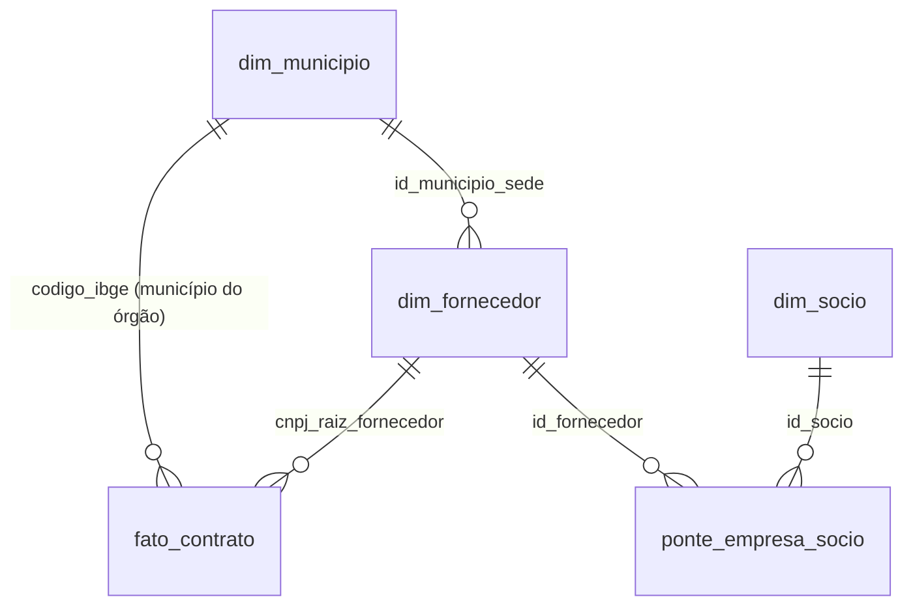

# Dicionário de dados

Descreve o modelo estrela consolidado no PostgreSQL da Aiven (T2): uma fato
reduzida de cinco colunas, as duas dimensões obrigatórias (`dim_fornecedor` e
`dim_municipio`), as duas tabelas da relação entre empresa e sócio (`dim_socio` e
`ponte_empresa_socio`) e dois agregados materializados para o painel
(`agg_kpi_genero_setor` e `agg_concentracao_socio`). A definição está em
`etl/schema_estrela.sql`, e o `etl/aplicar_schema.py` confere este dicionário
contra o `information_schema` do banco. É um dos itens obrigatórios do README
segundo o guia do projeto.

O desenho anterior tinha dez tabelas. Cinco saíram do banco (`dim_tempo`,
`dim_orgao`, `dim_unidade`, `dim_tipo_contrato` e `dim_categoria_processo`) e
estão registradas na seção "O que ficou fora do banco", com as estatísticas
que já tinham sido medidas.

As estatísticas de cardinalidade e domínio das tabelas abaixo foram medidas
sobre os 58.769 contratos de 1 a 20 de janeiro de 2025 `[AMOSTRA JAN]`, e não
estimadas. A primeira versão deste documento dizia que, com o ano completo, elas
mudariam de magnitude mas não de natureza. Isso não se confirmou em tudo: a
coleta completa de 2025 (2.023.134 contratos) mudou a composição de alguns
domínios. Os números do ano que importam para as regras estão na tabela a
seguir; os demais valem só como retrato de janeiro.

| estatística | amostra de janeiro | ano inteiro |
|---|---|---|
| órgãos distintos | 3.495 | 11.813 |
| contratos de órgão municipal | 56,3% | 69,89% |
| contratos por tipo de fornecedor (PJ, PF e PE) | 57.142, 1.400 e 227 | 1.941.824, 74.433 e 6.877 |
| contratos sem raiz de CNPJ | 1.650 | 82.784 |
| raízes de CNPJ distintas (contratos PJ com catorze dígitos) | 20.436 | 243.297 |
| `valorAcumulado` nulo | 55,99% | 38,68% |
| valor inicial diferente do global | 2,09% | 2,13% |
| mediana de `valor_global` (valor maior que zero) | R$ 4.260,00 (R$ 4.153,50 contando os zeros, número da primeira versão) | R$ 3.486,00 |
| maior `valor_global` | R$ 640 bilhões | R$ 6,03 trilhões |
| contratos acima de R$ 1 bilhão | 26, com 98,7% do valor | 243, com 95,77% do valor |

A Receita Federal já foi baixada e filtrada (239.600 empresas, 529.225
estabelecimentos e 339.385 sócios, competência 2026-09-14). A carga dela no
banco é a etapa pendente, e por isso as colunas que vêm da Receita continuam
marcadas como pendentes.

Convenções que valem para todo o modelo. Identificadores como CNPJ, CPF, CEP e
código de município são sempre texto, nunca número, porque zeros à esquerda são
significativos. Valores monetários são sempre `NUMERIC`, nunca ponto flutuante,
porque somar milhões de contratos em float acumula erro visível. Chaves
substitutas são inteiras e as chaves naturais ficam como restrição de
unicidade.

## Visão geral

| tabela | papel | grão (uma linha por) | chave primária |
|---|---|---|---|
| `fato_contrato` | fato | contrato | `numero_controle_pncp` |
| `dim_fornecedor` | dimensão | raiz de CNPJ, 8 dígitos | `id_fornecedor` |
| `dim_municipio` | dimensão | município, código IBGE de 7 dígitos | `id_municipio` |
| `dim_socio` | dimensão de apoio | sócio distinto | `id_socio` |
| `ponte_empresa_socio` | ponte, muitos para muitos | vínculo entre empresa, sócio, qualificação e competência | `(id_fornecedor, id_socio, qualificacao, competencia)` |
| `agg_kpi_genero_setor` | agregado | ano do contrato, CNAE, UF, faixa de `pct_negra` e controle da empresa | `(ano_contrato, uf_sigla, genero_controle, faixa_pct_negra, cnae_principal)` |
| `agg_concentracao_socio` | agregado | sócio pessoa física ligado a 2 ou mais empresas com contrato | `id_socio` |

## fato_contrato

Grão: um contrato. É a tabela de fatos do modelo.

Entram os contratos publicados em 2025 que passam pelo filtro de valor da RN-02
(maior que zero em centavos e até R$ 1 bilhão): 2.005.068 linhas, a mesma fato
medida no benchmark do PostgreSQL. Os 243 contratos acima de um bilhão ficam
fora da fato e listados no CSV de auditoria.

| coluna | tipo | chave | nulo | origem | observação |
|---|---|---|---|---|---|
| numero_controle_pncp | TEXT | PK | não | PNCP `numeroControlePNCP` | chave natural, única. Formato `00394460005887-2-007096/2024` |
| codigo_ibge | TEXT | FK para `dim_municipio.codigo_ibge` | sim | PNCP `unidadeOrgao.codigoIbge` | município do órgão contratante. Nulo se o código não existir em `dim_municipio` |
| cnpj_raiz_fornecedor | TEXT | FK para `dim_fornecedor.cnpj_raiz` | sim | derivada de `niFornecedor` | nulo quando o fornecedor não tem raiz de CNPJ (pessoa física, estrangeiro ou identificador irregular): 78.795 contratos, 3,9% da fato (RN-01) |
| valor_global | NUMERIC(18,2) | | não | PNCP `valorGlobal` | gravado em centavos, e é nesse valor que se aplica a RN-02. Mediana de R$ 3.486,00 no ano |
| ano_contrato | INTEGER | | sim | PNCP `anoContrato` | ano do contrato, e não o da publicação: 7,05% dos contratos publicados em 2025 têm 2024 (RN-02, Recorte). Varia de 2021 a 2025 |

Decisões que valem defesa.

As chaves estrangeiras são as chaves naturais, `codigo_ibge` e
`cnpj_raiz_fornecedor`, e não identificadores inteiros. É o desenho que o
benchmark mediu (177 MB sem índices, de 213 a 223 MB com os dois índices de
junção), e ele deixa o contrato legível sem junção. O custo é o índice da chave
primária em texto, que o benchmark não tinha, estimado em cerca de 95 MB: o total
das três tabelas deve ficar perto de 340 MB, dentro do orçamento utilizável de
500 a 700 MB, mas isso é estimativa e será medido na carga. O benchmark também
usou uma `dim_fornecedor` de três colunas, e a real tem dez.

A fato é reduzida de propósito, e o que saiu dela tem consequência. Sem a flag
`receita`, a exclusão dos contratos de receita (RN-02, decisão D9) não pode ser
aplicada pelos agregados: eles entram nos totais, cerca de 1,02% dos contratos e 1,6%
do valor, até a fato da Fase 2 trazer a coluna. Sem data de publicação, o único
eixo de tempo é `ano_contrato`, e o filtro de 2025 por publicação é feito no
Parquet antes da carga. Os atributos de órgão, unidade, tipo e categoria também
ficam só no Parquet.

O carregador é o `etl/carregar_fato.py`, que lê `etl/dados/benchmark/fato.parquet`,
a fato de 2.005.068 contratos medida no benchmark. Contrato sem raiz de CNPJ entra
com `cnpj_raiz_fornecedor` nulo. Raiz que não existe na Receita entra em
`dim_fornecedor` só com `cnpj_raiz` e os atributos nulos, para a chave estrangeira
não falhar. Código IBGE ausente de `dim_municipio` vira nulo. Os dois índices da
fato são derrubados antes da carga e recriados no fim. A carga é idempotente e
vai em lotes de 100 mil linhas.

Duas notas de qualidade sobre os dados desta tabela.

A primeira, sobre valor. O máximo bruto de `valor_global` no ano é de R$ 6,03
trilhões, e 243 contratos acima de um bilhão concentram 95,77% do valor somado
(em janeiro eram 26 contratos e 98,7%). Parte é erro de escala, e parte parece
ser teto estimado de credenciamento, hipótese ainda a confirmar. Eles ficam fora
da fato do banco e continuam listados no CSV de auditoria; a coluna que os marca
no Parquet entra na Fase 2 (RN-02, D3). O dicionário registra o valor bruto para
que ninguém se surpreenda ao consultar o dado antes do filtro.

A segunda, sobre parcelas. O máximo de `numero_parcelas` é 54.000, contra uma
mediana de 1. Um contrato com cinquenta e quatro mil parcelas não é plausível, e
esse campo merece um critério de sanidade próprio antes de ser usado em
qualquer métrica. O campo está só no Parquet, e ainda não há regra de negócio
para ele porque nenhuma pergunta analítica o consome hoje.

## dim_fornecedor

Grão: uma empresa, identificada pela raiz de oito dígitos do CNPJ. Origem
mista: PNCP para a chave, Receita Federal para os atributos cadastrais.

| coluna | tipo | chave | nulo | origem | situação |
|---|---|---|---|---|---|
| id_fornecedor | INTEGER | PK | não | gerada | |
| cnpj_raiz | TEXT | UNIQUE | não | derivada de `niFornecedor`, confirmada na Receita | 20.436 distintos em janeiro, 243.297 no ano. Nunca nulo: só existe para PJ com catorze dígitos (RN-01) |
| razao_social | TEXT | | sim | Receita, EMPRESAS coluna 2 | Parquet pronto, carga pendente |
| tipo_pessoa | TEXT | | sim | PNCP `tipoPessoa` (o roteiro chama de `tipoPessoaFornecedor`) | contratos por tipo em janeiro: PJ 57.142, PF 1.400, PE 227. Na dimensão, só entra PJ |
| natureza_juridica | TEXT | | sim | Receita, EMPRESAS coluna 3 | pendente. Grupo 1XXX identifica ente público |
| porte | TEXT | | sim | Receita, EMPRESAS coluna 6 | pendente. 00 não informado, 01 micro, 03 pequeno, 05 demais |
| capital_social | NUMERIC(18,2) | | sim | Receita, EMPRESAS coluna 5 | pendente. Vem com vírgula decimal |
| cnae_principal | TEXT | | sim | Receita, ESTABELECIMENTOS coluna 12 | pendente. 7 dígitos sem pontuação |
| id_municipio_sede | INTEGER | FK para `dim_municipio.id_municipio` | sim | Receita, ESTABELECIMENTOS coluna 21 | pendente. Exige tradução do código de município da Receita para o do IBGE |
| data_inicio_ativ | DATE | | sim | Receita, ESTABELECIMENTOS coluna 11 | pendente. Formato AAAAMMDD, ausente como 00000000 |

O grão é a raiz e não o CNPJ completo porque o quadro societário pertence à
empresa, não ao estabelecimento. Ver RN-01.

Os contratos sem raiz de CNPJ (1.650 em janeiro, 82.784 no ano) são os de
fornecedor pessoa física, estrangeiro ou com identificador irregular, que por
definição não têm quadro societário. Eles não entram nesta dimensão e ficam com
`cnpj_raiz_fornecedor` nulo na fato, formando o universo à parte da RN-01.

## dim_municipio

Grão: um município brasileiro. Origem dupla: identificação do IBGE e composição
racial do Censo 2022 via SIDRA, tabela 9605. A coleta está em
`etl/baixar_proxy_racial.py`, que grava
`etl/dados/proxy/cor_raca_municipio_2022.csv`, e a carga no banco está em
`etl/carregar_municipios.py`.

| coluna | tipo | chave | nulo | origem | observação |
|---|---|---|---|---|---|
| id_municipio | INTEGER | PK | não | gerada | |
| codigo_ibge | TEXT | UNIQUE | não | IBGE, 7 dígitos | é a chave que o PNCP e o SIDRA compartilham |
| nome | TEXT | | não | Censo 2022, SIDRA 9605 | o sufixo " - UF" do SIDRA é retirado na carga |
| uf_sigla | TEXT | | não | derivada dos dois primeiros dígitos do código | |
| pop_total | INTEGER | | sim | Censo 2022, SIDRA 9605 | soma das cinco categorias de cor ou raça, e não a categoria Total do SIDRA |
| pop_branca, pop_preta, pop_parda, pop_amarela, pop_indigena | INTEGER | | sim | idem | nulo significa não medido, zero significa zero |
| pct_negra | NUMERIC(6,3) | | sim | derivada | percentual de 0 a 100: (preta + parda) / `pop_total` × 100. Mín 2,5%, mediana 60,8%, máx 97,2% |

A tabela 9605 do Censo 2022 traz 5.570 municípios, todos com dado, e é essa a
dimensão carregada. `pop_total` é a soma das cinco categorias de cor ou raça,
como calcula o `baixar_proxy_racial.py`: 203.069.637 pessoas, 11.119 a menos
(0,005%) que o total de 203.080.756 que a categoria Total do SIDRA devolve. A
causa provável é população sem cor ou raça declarada, a confirmar. Por isso
`pct_negra` é a participação de pretos e pardos entre as pessoas com cor ou raça
declarada. Eles somam 55,5% do país. A lista de localidades do IBGE tem um
município a mais, Boa Esperança do Norte (MT, código 5101837), que não consta da
tabela, provavelmente porque foi instalado depois do Censo (a confirmar). Um
contrato de órgão desse município fica com `codigo_ibge` nulo na fato. Se o PNCP
usar esse código, o carregador aceita `--completar-localidades`, que o inclui
com populações e `pct_negra` nulos, e os agregados o classificam como `sem dado`.

Duas armadilhas registradas. A primeira: o código de município da Receita
Federal não é o código do IBGE, e ligar a sede da empresa a esta tabela exige
passar pela tabela de tradução distribuída no conjunto do CNPJ. A segunda: o
SIDRA devolve os valores como texto, usando traço para zero e reticências para
dado não disponível, e os dois casos não podem virar o mesmo número.

Sobre o uso desta dimensão, a nota que precisa acompanhar qualquer resultado:
ela descreve o território, nunca a pessoa. Ver RN-06.

## dim_socio

Grão: uma pessoa física ou jurídica que integra o quadro societário de alguma
empresa fornecedora. Origem: Receita Federal, arquivo de sócios.

| coluna | tipo | chave | nulo | origem | observação |
|---|---|---|---|---|---|
| id_socio | INTEGER | PK | não | gerada | |
| cpf_mascarado | TEXT | | sim | SOCIOS coluna 4 | chave interna. Formato `000***718468**`. Nunca exibido, ver RN-09. **Não é única**: pessoas diferentes colidem na mesma máscara (169.762 máscaras contra 195.748 pares de máscara e nome, na amostra de 200 mil linhas) |
| identificador_pub | TEXT | UNIQUE | não | derivada | hash de máscara, nome e sal. É o identificador exibível |
| identificador_tipo | SMALLINT | | sim | SOCIOS coluna 2 | 1 pessoa jurídica, 2 pessoa física, 3 estrangeiro |
| faixa_etaria | SMALLINT | | sim | SOCIOS coluna 11 | 1 a 9 em faixas de dez anos; 0 não se aplica |
| genero | TEXT | | sim | inferido | feminino, masculino ou indeterminado. Nulo significa ainda não classificado. Ver RN-04 |
| confianca_genero | NUMERIC(5,4) | | sim | inferido | proporção dominante do primeiro nome |

O nome do sócio existe na origem mas não é coluna desta tabela: ele entra como
insumo da inferência de gênero e é descartado, restando o identificador
derivado. Essa é a aplicação concreta da RN-09.

A coluna `genero` admite indeterminado como valor legítimo, e não como ausência.
Nos 327.180 sócios pessoa física do recorte nacional, 4,0% ficaram
indeterminados, e essa taxa é resultado, não falha. A base de nomes é a do Censo
Demográfico 2022, consultada pela API v3 do IBGE; o roteiro cita o Censo 2010,
base da API v2, que só foi usada no piloto inicial (5,7% de indeterminados) e
não em nenhum número atual.

## ponte_empresa_socio

Grão: um vínculo entre empresa e sócio, numa competência. É a tabela que
resolve a cardinalidade de muitos para muitos, e a decisão de modelagem que o
projeto defende.

| coluna | tipo | chave | nulo | origem | observação |
|---|---|---|---|---|---|
| id_fornecedor | INTEGER | PK, FK para `dim_fornecedor` | não | FK | parte da chave primária |
| id_socio | INTEGER | PK, FK para `dim_socio` | não | FK | parte da chave primária |
| qualificacao | TEXT | PK | não | SOCIOS coluna 5 | código da tabela de domínio da Receita |
| competencia | TEXT | PK | não | nome do arquivo | formato AAAA-MM |
| grupo_qualificacao | TEXT | | sim | derivada | participacao, titularidade, administracao, representacao, outro |
| data_entrada | DATE | | sim | SOCIOS coluna 6 | não existe data de saída |

A competência faz parte da chave primária de propósito. O arquivo da Receita é
um retrato do momento e não tem data de saída da sociedade, de modo que a única
forma de reconstruir entradas e saídas é comparar competências sucessivas. Se a
competência ficasse fora da chave, o modelo impediria por construção exatamente
esse caminho.

A coluna `grupo_qualificacao` é derivada porque filtrar por código solto é o
erro clássico desse arquivo: usar apenas o código 22, de sócio, perderia o
titular que aparece como 65, como o de EIRELI. O empresário individual e o MEI
não aparecem no arquivo de sócios em código nenhum (ver RN-03 e RN-05). Os
grupos estão enumerados na RN-03.

## Agregados materializados

O painel lê só estas duas tabelas, e nunca a fato diretamente (ver `docs/escolha-do-banco.md`). Elas são montadas por `etl/construir_agregados.py`, em fatias e dentro de uma transação, e não por `MATERIALIZED VIEW`: o `REFRESH` de uma view é uma consulta única sobre a fato inteira, que é o tipo de consulta que derrubou o nó gratuito no benchmark. O raciocínio e o orçamento de disco estão em `docs/agregados-e-orcamento-de-disco.md`. Depois de carregar contratos ou de classificar o gênero dos sócios, é preciso rodar o script de novo.

### agg_kpi_genero_setor

Grão: uma linha por combinação de ano do contrato, CNAE, UF, faixa de `pct_negra` e classificação de controle da empresa. Serve ao KPI 1 e à camada interseccional. O território é o município do órgão contratante.

| coluna | tipo | chave | nulo | origem | observação |
|---|---|---|---|---|---|
| ano_contrato | SMALLINT | PK | não | `fato_contrato.ano_contrato` | `0` significa sem ano |
| cnae_principal | TEXT | PK | não | `dim_fornecedor.cnae_principal` | `sem cnae` quando a empresa não tem matriz na Receita |
| uf_sigla | TEXT | PK | não | `dim_municipio.uf_sigla`, por `fato_contrato.codigo_ibge` | `sem uf` quando o município do órgão não existe em `dim_municipio` |
| faixa_pct_negra | TEXT | PK | não | derivada de `dim_municipio.pct_negra` | `alta` (70 ou mais), `media` (40 ou mais), `baixa`, ou `sem dado` |
| genero_controle | TEXT | PK | não | derivada da RN-05 | `feminino`, `masculino`, `misto ou indeterminado`, `indeterminado`, `sem socio na base` ou `nao classificado` |
| contratos | BIGINT | | não | contagem | contratos do grupo |
| valor_total | NUMERIC(20,2) | | não | soma de `fato_contrato.valor_global` | em R$ |

A chave primária se chama `ix_agg_kpi_genero_pk` e é composta pelas cinco colunas de grupo, o que garante o grão. Só entram contratos com `cnpj_raiz_fornecedor` preenchido (RN-01). A mediana de valor não existe nesta tabela: não é aditiva e exigiria ordenar a fato inteira. A classificação de controle aplica a RN-05, e `nao classificado` aparece enquanto algum sócio da empresa estiver sem gênero. A RN-02 não está aplicada, porque a fato não tem a flag `receita`.

### agg_concentracao_socio

Grão: uma linha por sócio pessoa física ligado a duas ou mais empresas com contrato (RN-07). Serve ao KPI 4.

| coluna | tipo | chave | nulo | origem | observação |
|---|---|---|---|---|---|
| id_socio | INTEGER | PK, FK para `dim_socio` | não | `dim_socio.id_socio` | |
| empresas | INTEGER | | não | contagem | empresas do sócio com contrato, pelos grupos participação e titularidade |
| contratos | BIGINT | | não | soma | contratos dessas empresas |
| valor_controlado | NUMERIC(20,2) | | não | soma de `fato_contrato.valor_global` | em R$ |
| soma_sobreposta | BOOLEAN | | não | derivada | verdadeiro quando alguma empresa do sócio tem mais de um sócio multiempresa: o mesmo valor entra na soma de cada um |
| identificador_pub | TEXT | | não | `dim_socio.identificador_pub` | único identificador exibível (RN-09) |
| genero | TEXT | | sim | `dim_socio.genero` | nulo significa ainda não classificado |

Existe o índice `ix_agg_concentracao` em `valor_controlado` decrescente. Nenhum recorte do painel mostra resultado baseado em menos de cinco sócios ou cinco empresas, e esse filtro fica na camada de apresentação (RN-09).

## O que ficou fora do banco

Estas cinco tabelas faziam parte do desenho de dez tabelas e saíram do
PostgreSQL na T2, para a fato caber no orçamento do plano gratuito. Os atributos
continuam como colunas do Parquet de contratos (`tratar_contratos.py`), e as
estatísticas abaixo continuam valendo como descrição dessa camada.

### dim_tempo

Grão: um dia. A chave era a própria data no formato AAAAMMDD, com ano, mês,
trimestre e dia da semana pré-calculados. Saiu porque a fato reduzida guarda só
`ano_contrato`.

### dim_orgao

Grão: um órgão contratante. Origem: objeto `orgaoEntidade` do PNCP.

| coluna | tipo | origem | domínio medido |
|---|---|---|---|
| id_orgao | INTEGER | gerada | |
| cnpj | TEXT | `orgaoEntidade.cnpj` | 3.495 distintos em janeiro (11.813 no ano), único |
| razao_social | TEXT | `orgaoEntidade.razaoSocial` | espaços normalizados |
| poder | TEXT | `orgaoEntidade.poderId` | E 30.863, N 24.917, L 1.985, J 1.004 |
| esfera | TEXT | `orgaoEntidade.esferaId` | M 33.091, F 17.023, E 7.730, N 862, D 63 |

A distribuição por esfera merece atenção analítica: a base é predominantemente
municipal, com 69,89% dos contratos do ano (56,3% em janeiro), e não federal.
Isso tem consequência direta sobre heterogeneidade de preenchimento. As
contagens por poder e esfera da tabela acima são de janeiro.

### dim_unidade

Grão: uma unidade administrativa dentro de um órgão. Origem: `unidadeOrgao`, com
`codigoUnidade` (4.215 distintos em janeiro), `nomeUnidade` e o município por
`unidadeOrgao.codigoIbge`.

### dim_tipo_contrato

Origem: objeto `tipoContrato` do PNCP, que já vem no padrão código mais
descrição. Oito valores distintos na base medida.

| id | nome | ocorrências |
|---|---|---|
| 7 | Empenho | 27.692 |
| 1 | Contrato (termo inicial) | 19.002 |
| 8 | Outros | 11.888 |
| 5 | Termo de Adesão | 74 |

### dim_categoria_processo

Origem: objeto `categoriaProcesso` do PNCP. Onze valores distintos.

| id | nome | ocorrências |
|---|---|---|
| 2 | Compras | 40.667 |
| 8 | Serviços | 14.713 |
| 10 | Serviços de Saúde | 792 |
| 9 | Serviços de Engenharia | 660 |

## Domínios codificados que vêm da Receita

Estes não viram tabela no nosso modelo porque a Receita já distribui as tabelas
de domínio no próprio conjunto. Ficam registrados aqui para leitura do dado.

Identificador de sócio: 1 pessoa jurídica, 2 pessoa física, 3 estrangeiro.

Porte da empresa: 00 não informado, 01 microempresa, 03 empresa de pequeno
porte, 05 demais. Os códigos 02 e 04 não existem.

Situação cadastral: 01 nula, 02 ativa, 03 suspensa, 04 inapta, 08 baixada. O
PDF oficial mistura a grafia com e sem zero à esquerda, então convém normalizar
para dois caracteres antes de comparar.

Identificador de matriz ou filial: 1 matriz, 2 filial.

Faixa etária do sócio: 1 de 0 a 12 anos, 2 de 13 a 20, 3 de 21 a 30, 4 de 31 a
40, 5 de 41 a 50, 6 de 51 a 60, 7 de 61 a 70, 8 de 71 a 80, 9 maiores de 80, 0
não se aplica, tipicamente sócio pessoa jurídica.

Qualificação do sócio: são sessenta e seis códigos, não contíguos, agrupados
para uso do projeto na RN-03.

## Campos do bruto que não entram no modelo

Registrados para que a ausência seja decisão explícita e não esquecimento.

O campo `objetoContrato`, texto livre, permanece na camada Parquet e não entra
no PostgreSQL. A justificativa de custo está em `docs/escolha-do-banco.md`.

Os campos `orgaoSubRogado` e `unidadeSubRogada` vêm preenchidos em 0,31% dos
contratos do ano (a chave existe em todos, com valor nulo) e não são consumidos
por nenhuma pergunta analítica.

O campo `valorAcumulado` é nulo em 38,68% dos contratos do ano (55,99% em
janeiro), o que ainda o inviabiliza como métrica principal.

Os campos de telefone, fax e correio eletrônico dos estabelecimentos da Receita
são dados pessoais de contato e não entram no modelo, por aplicação da RN-09.